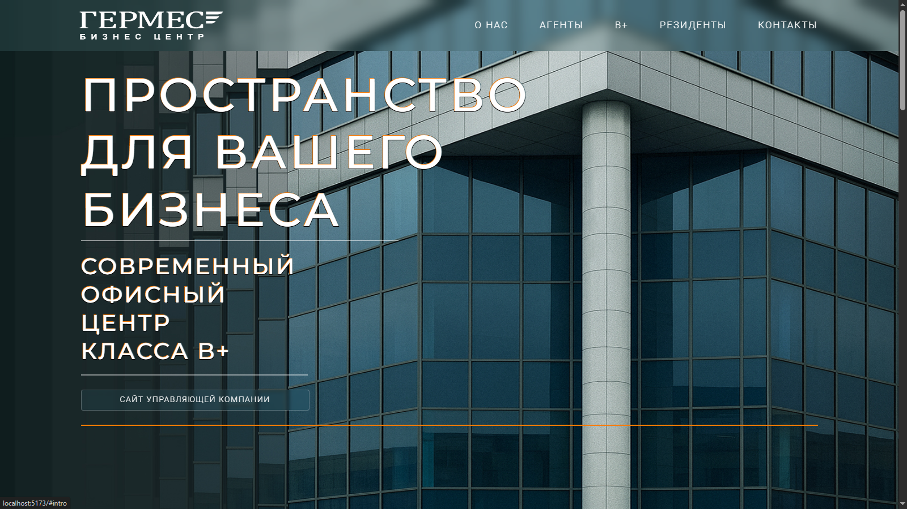
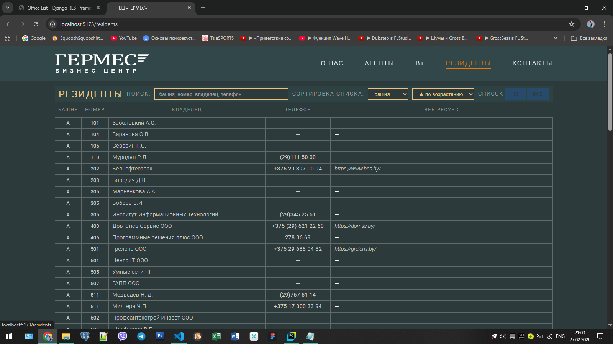
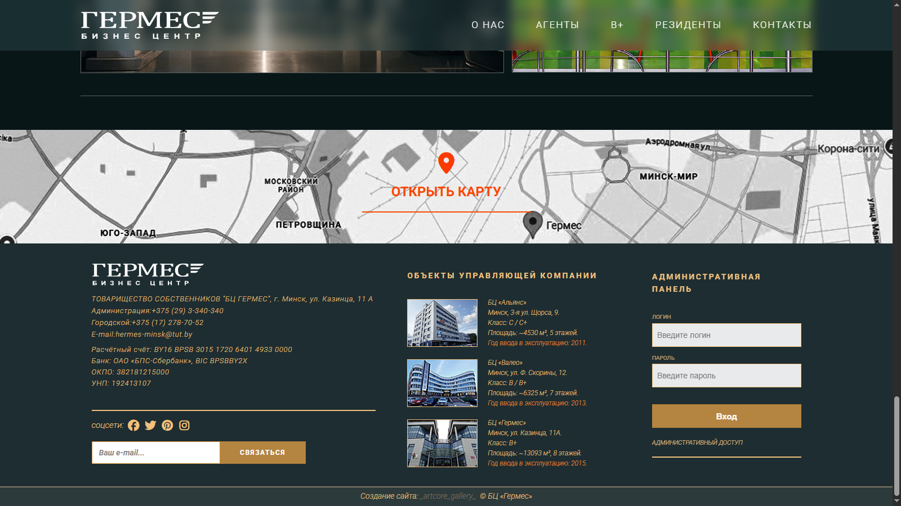
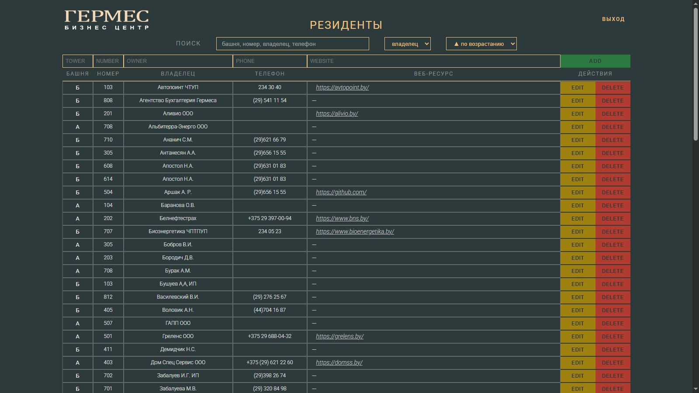

# Hermes Directory

Публичный справочник резидентов бизнес-центра «Гермес» и административная панель Office. Публичная таблица поддерживает поиск по башне, номеру, владельцу и телефону, сортировку и показ всех записей. Сотрудники и суперпользователи могут создавать, редактировать и удалять записи.

## Архитектура и структура

React 19, Vite 7 и Axios обращаются к Django 5.2, Django REST Framework 3.16 и SimpleJWT. Django использует SQLite по умолчанию. Профиль `prod` поддерживает PostgreSQL.

| Путь | Назначение |
|---|---|
| `requirements.txt` | Версии зависимостей Python |
| `hermes_directory_backend/api_hermes/` | Модель Office, API, валидация, миграции и тесты |
| `hermes_directory_backend/base_hermes/` | Маршруты и профили настроек Django |
| `hermes_directory_backend/scripts/` | Подготовка данных для локального Playwright |
| `hermes_directory_frontend/src/` | React-приложение и клиент API |
| `hermes_directory_frontend/e2e/` | Сценарии Playwright |
| `.github/workflows/ci.yml` | CI и проверки готовности к развёртыванию |

Базовые версии для CI и нового компьютера — **Python 3.12** и **Node.js 22.12+ в ветке 22**. Workflow выбирает Node.js 22, а 22.12 — минимальная версия этой ветки для используемого Vite. Проверенное локальное окружение — **Python 3.13.17** и **Node.js 26.13.1**.

## Первый запуск в Windows PowerShell

Откройте PowerShell в корне клонированного проекта. Установите Python, Node.js и npm, затем создайте окружение и установите зависимости Backend:

```powershell
py -3.12 -m venv .venv
.\.venv\Scripts\python.exe -m pip install -r requirements.txt
if (!(Test-Path .\hermes_directory_backend\.env)) {
    Copy-Item .\hermes_directory_backend\.env.example .\hermes_directory_backend\.env
}
```

В `hermes_directory_backend/.env` выберите `base_hermes.settings.dev`, задайте собственный `SECRET_KEY` и проверьте, что `ALLOWED_HOSTS` включает `localhost` и `127.0.0.1`. Шаблон предусматривает `AUTH_COOKIE_SECURE=False` для локального HTTP. Значения для рабочей среды задаются отдельно. Файл `.env` игнорируется Git.

В первом терминале из корня запустите Backend. Если база уже существует, сначала выполните резервное копирование по инструкции ниже.

```powershell
Set-Location .\hermes_directory_backend
..\.venv\Scripts\python.exe manage.py migrate
if ($LASTEXITCODE -ne 0) { throw "Migration failed" }
..\.venv\Scripts\python.exe manage.py createsuperuser
..\.venv\Scripts\python.exe manage.py runserver 127.0.0.1:8000
```

`createsuperuser` нужен для создания первой административной учётной записи. Во втором терминале из корня запустите Frontend:

```powershell
Set-Location .\hermes_directory_frontend
npm ci
npm run dev -- --host 127.0.0.1 --port 5173 --strictPort
```

Откройте [http://localhost:5173](http://localhost:5173). Vite проксирует `/api` на `127.0.0.1:8000`. При другом адресе Backend задайте `VITE_API_PROXY_TARGET` в PowerShell перед запуском Vite.

### Доступ по сетевому IP

Запуск выше слушает только loopback. Для доступа с другого устройства Vite должен слушать сетевой интерфейс, а полный браузерный origin со схемой, IP и портом нужно добавить в `CSRF_TRUSTED_ORIGINS` Backend. Сетевой IP и `localhost` — разные origin. Без настройки запросы с изменениями могут получить `403 CSRF`, даже когда справочник открывается. Оставьте в `ALLOWED_HOSTS` хост, который получает Django, и добавляйте `CORS_ALLOWED_ORIGINS` только при прямых запросах браузера к отдельному origin Backend.

### Временный доступ через ngrok

Запустите `ngrok http http://127.0.0.1:5173` на той же машине. В отдельном PowerShell из каталога Frontend разрешите только точное имя назначенного туннеля без схемы, порта и пути.

```powershell
$env:__VITE_ADDITIONAL_SERVER_ALLOWED_HOSTS = "<хост-туннеля>"
npm run dev -- --port 5173 --strictPort
```

Ограничьте доступ на стороне ngrok, используйте тестовые данные и остановите туннель после демонстрации. Туннель открывает доступ и к проксируемому `/api`. Для работы административной формы добавьте точный HTTPS-origin туннеля в `CSRF_TRUSTED_ORIGINS` Django и перезапустите Backend. После демонстрации удалите временный origin и закройте PowerShell с переменной туннеля.

## Миграции и резервное копирование

На новом компьютере `migrate` создаёт схему базы. **Перед миграцией существующей базы остановите процессы, которые могут в неё писать, и сделайте резервную копию вне репозитория.** Для SQLite используйте API резервного копирования SQLite или копируйте файл после корректной остановки всех писателей и проверки, что нет активного WAL. Для PostgreSQL используйте `pg_dump`. Проверьте, что копия читается, и сначала примените миграцию к отдельной копии данных.

Миграция Office `0002` требует башню `A/B/a/b` и номер из одной или двух ASCII-цифр. При несовместимых данных она остановится и перечислит ID записей. Исправьте данные на основании проверенного источника перед повторным запуском.

## Авторизация и API

| Маршрут | Назначение |
|---|---|
| `/api/v1/offices/`, `/api/v1/offices/{id}/` | Публичное чтение. Создание, изменение и удаление доступны staff и суперпользователям |
| `/api/v1/auth/login/`, `refresh/`, `logout/` | Вход, обновление и завершение сессии через POST |
| `/api/v1/auth/me/`, `csrf/` | Текущий пользователь и получение CSRF-токена через GET |
| `/api/v1/health/live/`, `ready/`, `deep/` | Проверки состояния Backend |
| `/swagger/`, `/redoc/` | Документация API |

Браузерный клиент использует совместимый префикс `/api/`. JWT передаются в HttpOnly cookies, а для запросов с изменениями клиент отправляет `X-CSRFToken` из `csrftoken`. При переводе браузерного клиента на `/api/v1/auth/` нужно учесть, что путь refresh-cookie по умолчанию — `/api/auth/`.

Список Office использует пагинацию DRF с размером страницы 20 и максимумом 100 через `page_size`. Обе таблицы загружают все страницы по `next` перед показом списка и сообщают об ошибке, если загрузка оборвалась. API возвращает ошибки в формате `error.code`, `error.message`, `error.details` и `error.trace_id`.

## Проверки

Из `hermes_directory_backend/`:

```powershell
..\.venv\Scripts\python.exe manage.py check
..\.venv\Scripts\python.exe manage.py makemigrations --check
..\.venv\Scripts\python.exe manage.py test
```

Из `hermes_directory_frontend/`:

```powershell
npm run build
npm run lint
```

Известные нерешённые ошибки ESLint — `no-undef` для `process` в настройках Vite, Playwright и smoke-тесте, а также `no-unused-vars` для переменных в `AdminFooter.jsx`, `AdminLogin.jsx` и `AdminPanel.jsx`. Состояние зависимостей требует отдельного аудита.

### Playwright на отдельной SQLite-базе

`npm run test:e2e:smoke` запускает весь набор `e2e/`. По умолчанию Playwright может переиспользовать серверы, а при самостоятельном запуске Backend выполняет миграции и заполняет базу тестовыми данными. **Не запускайте локальный набор с рабочей базой.** Освободите порты 8000 и 5173. В отдельном PowerShell из корня создайте временный профиль, чтобы тесты запускали свои серверы и использовали отдельную базу:

```powershell
$e2eDir = Join-Path ([IO.Path]::GetTempPath()) ("hermes-e2e-" + [guid]::NewGuid())
New-Item -ItemType Directory -Path $e2eDir | Out-Null
@'
from pathlib import Path
from base_hermes.settings.dev import *

DATABASES = {
    "default": {
        "ENGINE": "django.db.backends.sqlite3",
        "NAME": Path(__file__).with_name("e2e.sqlite3"),
    }
}
ALLOWED_HOSTS = ["127.0.0.1", "localhost", "testserver"]
CSRF_TRUSTED_ORIGINS = ["http://127.0.0.1:5173", "http://localhost:5173"]
AUTH_COOKIE_DOMAIN = None
AUTH_COOKIE_SECURE = False
'@ | Set-Content (Join-Path $e2eDir "hermes_e2e_settings.py") -Encoding UTF8

$env:PATH = "$(Resolve-Path .\.venv\Scripts);$env:PATH"
$env:PYTHONPATH = $e2eDir
$env:DJANGO_SETTINGS_MODULE = "hermes_e2e_settings"
$env:CI = "1"
$env:PLAYWRIGHT_USE_LOCAL_SERVERS = "true"
$env:PLAYWRIGHT_BASE_URL = "http://127.0.0.1:5173"
$env:VITE_API_PROXY_TARGET = "http://127.0.0.1:8000"

Set-Location .\hermes_directory_frontend
npx playwright install chromium
npm run test:e2e:smoke -- --output (Join-Path $e2eDir "results")
```

Закройте тестовый PowerShell после прогона, чтобы настройки изоляции не перешли в обычный запуск. База и результаты находятся в созданном временном каталоге.

## Production и staging

Используйте `base_hermes.settings.prod`, `DEBUG=False`, собственный `SECRET_KEY`, точные `ALLOWED_HOSTS` и HTTPS. Проверьте настройки доверенных origin и secure cookies, включая `AUTH_COOKIE_SECURE=True`. При выборе PostgreSQL задайте `USE_POSTGRES=True` и параметры `POSTGRES_*` по шаблону `.env.example`. Поддержка PostgreSQL и проверка профиля предусмотрены в CI. Это не подтверждает развёртывание на конкретном staging или production.

На целевой среде выполните `manage.py check --deploy`, `manage.py migrate --noinput` и `manage.py collectstatic --noinput` после резервного копирования существующей базы. Раздавайте результат `npm run build` с поддержкой маршрутов SPA и направляйте `/api` к Django через веб-сервер.

Для post-deploy smoke в GitHub Actions предусмотрены секреты `STAGING_BASE_URL`, `STAGING_ADMIN_USERNAME`, `STAGING_ADMIN_PASSWORD` и необязательная переменная `STAGING_RESIDENT_OWNER`. Job рассчитан на уже развёрнутый и подготовленный staging. Он задаёт `PLAYWRIGHT_USE_LOCAL_SERVERS=false` и передаёт адрес через `PLAYWRIGHT_BASE_URL`.

## Скриншоты








